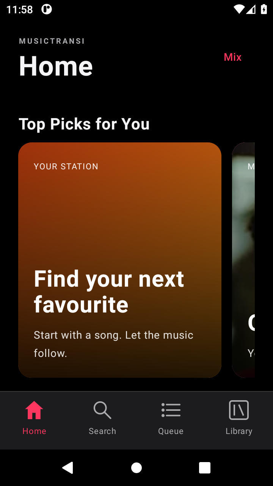
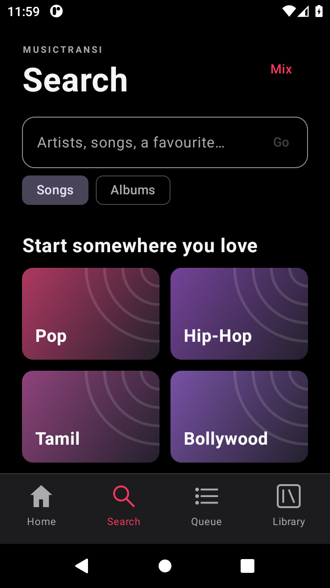
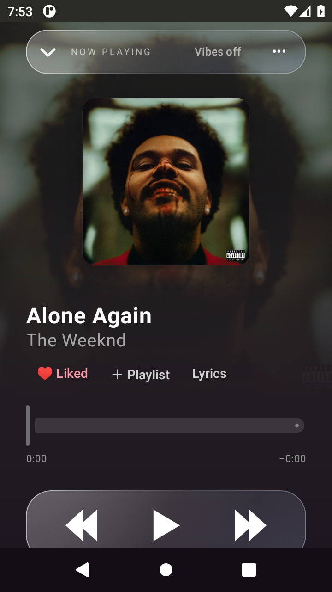
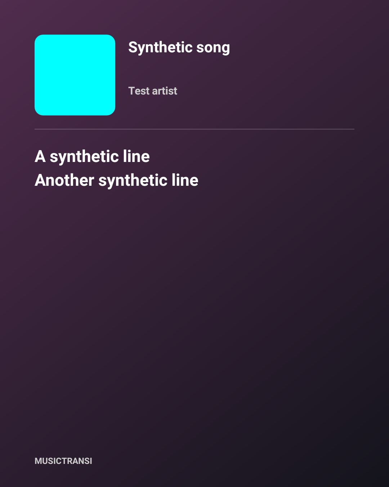

# MusicTransi

An artwork-led music player built around smooth listening: automatic song discovery, a two-deck transition engine, synced lyrics, music haptics, queues, playlists, offline collections and expressive player designs.

> MusicTransi is an experimental preview. The current Android build is the most complete version. The iPhone package is native SwiftUI source that must be built and signed with Xcode on a Mac.

## See it in action

  
  
  
  

The interface combines a dark artwork-first home screen, fast search, an ambient full-screen player and shareable lyric cards. Album colours fade into the background, covers move with next/previous navigation, and the optional glass controls stay readable over changing artwork.

## Download

| Download | What you get | Status |
|---|---|---|
| [Android v0.12 APK](https://github.com/lkghost327-afk/MusicTransi/releases/download/v0.12/MusicTransi-v0.12-preview.apk) | Installable Android 8+ preview | Debug signed; tested on Android 11 emulator |
| [Older Android builds](https://github.com/lkghost327-afk/MusicTransi/releases/tag/android-archive) | APK archive from v0.2 through v0.11 | Kept for testing and comparison |
| [iPhone v0.12 Mac kit](https://github.com/lkghost327-afk/MusicTransi/releases/download/v0.12/MusicTransi-Mac-iPhone-v0.12-kit.zip) | SwiftUI project, Mac companion and guide | Requires Xcode and personal signing; no signed IPA |

Install Android updates over the existing preview to retain local app data. Check the supplied SHA-256 files before sideloading. The historical archive intentionally omits v0.5 and v0.8 because those APK files are not available.

## Highlights

- **Listening that keeps moving:** autoplay and Discover mixes use listening history, likes and related artists while filtering trailers, repeats, lyric uploads, bass-boosted edits and other unwanted variants.
- **Transition engine:** two playback decks, beat-grid analysis, tempo matching, beat-aligned entry, gain envelopes and bass handoff. A confidence-based fallback keeps uncertain tracks from being overprocessed.
- **Immersive playback:** artwork-derived backgrounds, directional cover changes, optional Liquid Glass, Record, Vinyl, turntable and Orbit designs.
- **Lyrics and haptics:** synced lyrics with seeking controls, selectable lyric sharing cards, and optional music-following vibration with timing adjustment.
- **A real library:** liked songs, albums, editable playlists, custom covers, queue controls, search history and CSV/JSON library imports.
- **Offline tools:** download playlists, liked songs and albums with progress, retries, removal and Wi-Fi controls.
- **System playback:** artwork and previous/play/pause/next/like controls in Android notifications and on the lock screen.

## Platform notes

### Android

Android is the primary implementation. See the [Android guide](android-app/README.md), [changelog](android-app/CHANGELOG.md) and [verification results](android-app/VERIFICATION.md). Release files contain no subscription audio, provider credentials or user data.

### iPhone

Follow the [Mac installation guide](ios-app/MAC-IPHONE-GUIDE.md). Keep the same signing team and bundle ID when updating. Online playback requires the companion Mac; imported local audio works independently.

The iPhone source includes native SwiftUI playback, directional artwork, lyric sharing, recent-history radio exclusions and supported-system Liquid Glass. It is not yet at Android feature parity, and it has not been compiled or physically tested from this Windows development machine. See [iPhone verification and limitations](ios-app/VERIFICATION.md).

## Current preview limitations

- Beat synchronization has a known regression and is not equivalent to Apple Music AutoMix yet.
- Physical-device haptic timing, battery impact and animation frame times have not been benchmarked across the wider Android device range.
- Online source availability and recommendation quality can change with provider and network conditions.
- The Android APK is a development preview signed with a debug key, so it should not be treated as a production-store build.

## Project layout

| Path | Purpose |
|---|---|
| `android-app/` | Kotlin/Jetpack Compose Android app and JVM companion |
| `ios-app/` | Native SwiftUI iPhone source and Mac installation tools |
| `index.html`, `css/`, `js/` | Original browser prototype |
| `package_*.py` | Reproducible preview packaging scripts |

MusicTransi is GPL-3.0 licensed. Read the [third-party notices](android-app/THIRD_PARTY.md) before redistribution. No affiliation with Apple, Spotify, Amazon, YouTube or other music providers is claimed.
